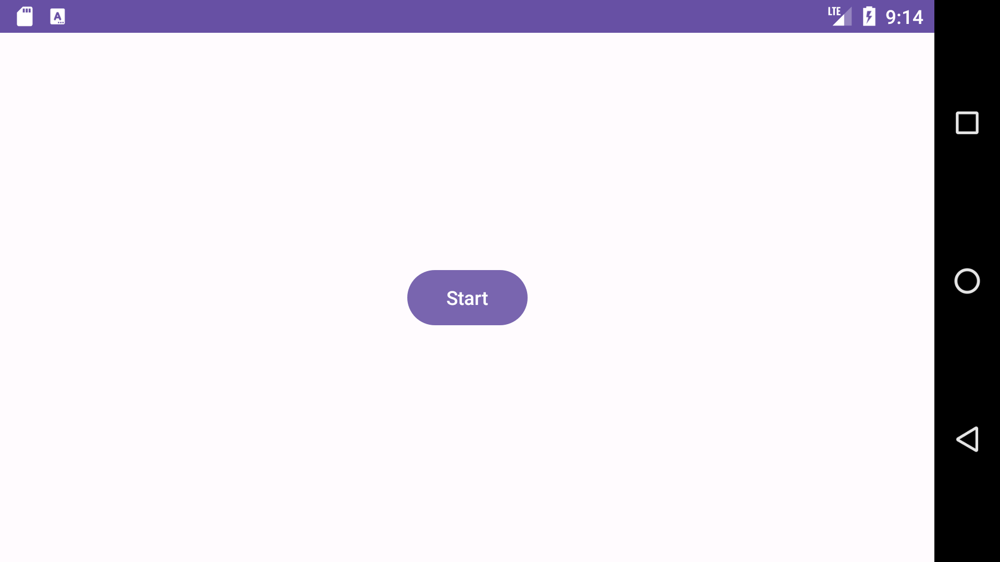
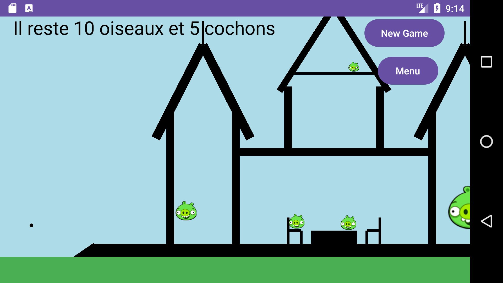
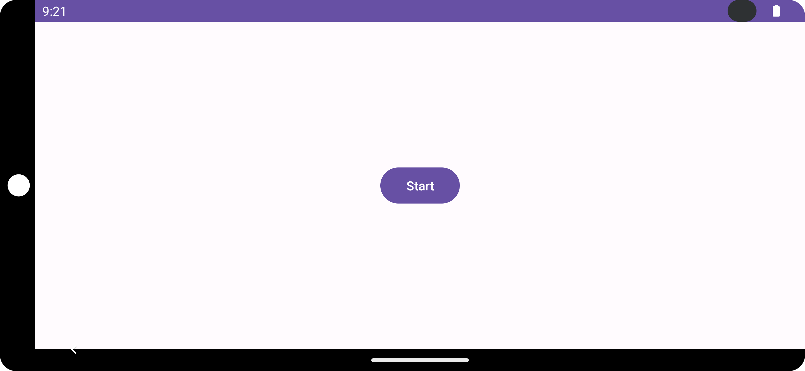

# Angry Ducks

A Kotlin/Android recreation of Angry Birds, developed for the second-year
computing project at Polytech ULB.

## Screenshots

| Screenshot 1 | Screenshot 2 | Screenshot 3 |
| --- | --- | --- |
|  |  |  |

## Project structure

- `app/`: Android application source, resources, and application build settings.
- `build.gradle`, `settings.gradle`: project build configuration.
- `gradle/`, `gradlew`, `gradlew.bat`: Gradle wrapper.

## Open and build

1. Clone or download the repository and open its root folder in Android Studio.
2. Configure a local Android SDK and allow Gradle to sync.
3. Select the `app` module and an emulator or device with Android API 24 or newer.
4. Build and run the application from Android Studio.

The committed configuration uses Gradle 8.0, compile/target SDK 33, and minimum
SDK 24. Use a JDK compatible with the project's Android Gradle Plugin.

With the Android SDK configured, the wrapper can also build a debug APK:

```sh
sh gradlew assembleDebug
```

On Windows, use `gradlew.bat assembleDebug`. Configure `local.properties` for
your own SDK installation rather than reusing another machine's SDK path.

## Status

This repository preserves an academic project. The screenshots are existing
project assets. A current Android build and device run have not been verified
as part of this documentation update.
